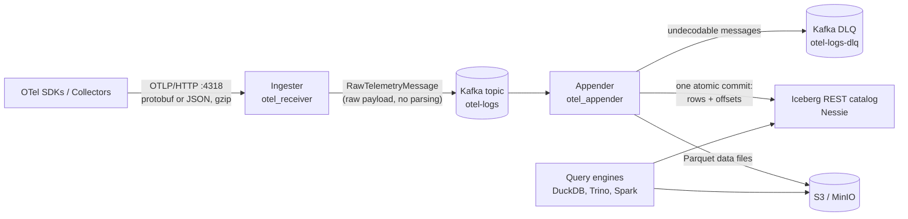
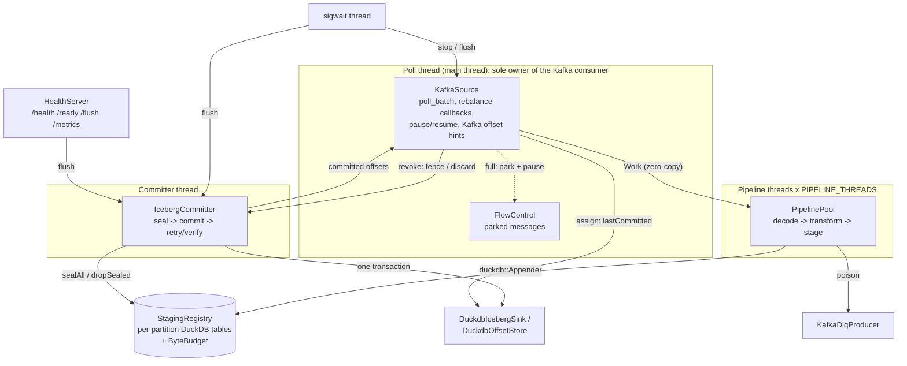

# Telemetry Lake: design

Telemetry Lake ingests OpenTelemetry logs over OTLP/HTTP, buffers them in Kafka, and writes them to an Apache Iceberg table that SQL engines can query. This document describes the two services, the end-to-end data flow, and exactly what each hop guarantees. Code references are relative links with line numbers as of this revision.



## 1. Goals and non-goals

**Goals**
- Accept OTLP/HTTP logs (protobuf and JSON, optionally gzip) and answer with OTLP-compliant status codes, so standard exporters retry correctly.
- Decouple ingestion from storage with Kafka, so storage outages do not reject telemetry.
- Write each log record that reaches Kafka into Iceberg **exactly once**, across crashes, restarts, retries and consumer-group rebalances.
- Never drop data silently. Data that cannot be stored is either retried, sent to a dead-letter topic, or makes the process stop.
- Keep memory bounded under load and during outages.

**Non-goals (today)**
- Metrics and traces (the wrapper has a `telemetry_type` field so they can be added).
- Exactly-once from the *client* to Kafka; see [6.2](#62-client--kafka-ingester).
- Iceberg table maintenance (compaction, snapshot expiry) of the logs table. That is left to external jobs.

## 2. Components at a glance

| Component | Binary / code | Role |
|---|---|---|
| Ingester | `otel_receiver`, [`src/ingester/`](../src/ingester) | Validates OTLP/HTTP requests, wraps the raw body, produces to Kafka |
| Kafka topic | `KAFKA_TOPIC` (`otel-logs`) | Durable, partitioned buffer; one message per accepted request |
| Appender | `otel_appender`, [`src/appender/`](../src/appender) | Consumes, decodes, transforms, stages and commits to Iceberg |
| Logs table | `lake."default"."logs"` | The data, partitioned by `day(timestamp)` |
| Offsets table | `lake."default"."_appender_offsets"` | Append-only record of which Kafka offsets each commit made durable; **the source of truth for recovery** |
| DLQ topic | `KAFKA_DLQ_TOPIC` (`<topic>-dlq`) | Messages that can never be decoded, with their original bytes |

## 3. Ingester

### 3.1 Request path

All in [`HttpServer::setupRoutes`](../src/ingester/http_server.cpp#L199). `POST /v1/logs` runs these steps in order, each cheaper than the next:

1. **Body size**: if it exceeds `MAX_BODY_BYTES` the response is 413 ([http_server.cpp:222](../src/ingester/http_server.cpp#L222)).
2. **Media type**: `application/x-protobuf`, `application/protobuf`, `application/json` and `text/json` are accepted; anything else gets 415 ([:228](../src/ingester/http_server.cpp#L228)). The canonical lowercase name is recorded, so the appender can switch on it exactly.
3. **Content-Encoding**: `gzip`/`x-gzip`/identity, otherwise 415.
4. **Load shedding**: if the producer already has `MAX_IN_FLIGHT` undelivered messages, the response is 503 with `Retry-After` *before* any decompression work ([:242](../src/ingester/http_server.cpp#L242)).
5. **Decompression** with a hard output cap (`MAX_DECOMPRESSED_BYTES`): 413 if it is exceeded, 400 if the input is corrupt ([`decompressGzip`](../src/ingester/http_server.cpp#L83)).
6. **Wrap without parsing**: the decompressed body goes verbatim into a [`RawTelemetryMessage`](../proto/telemetry_wrapper.proto#L13) `{content_type, telemetry_type = OTEL_LOGS, payload}`. The ingester never parses OTLP. That keeps it cheap and stateless and moves all parsing (and its failure modes) into the appender, where they can be handled per message.
7. **Produce** and map the result to an OTLP response ([:273](../src/ingester/http_server.cpp#L273)): 200 on success, 503 for queue-full and retryable broker errors, 413 if the message exceeds `message.max.bytes`, 500 for persistent errors. Error bodies are `google.rpc.Status` in the request's wire format, as OTLP/HTTP requires.

`/health` is liveness. `/ready` is 503 while the producer is not usable ([:210](../src/ingester/http_server.cpp#L210)). The process exits at startup if the producer cannot be created ([src/main.cpp](../src/main.cpp)), so it never serves traffic it would drop.

### 3.2 Producer

[`QueueProducer`](../src/ingester/queue_producer.cpp) uses librdkafka directly:
- `acks=-1` (all in-sync replicas) and `enable.idempotence=true` ([queue_producer.cpp:61-68](../src/ingester/queue_producer.cpp#L61)). Internal retries therefore cannot duplicate or reorder messages within a partition.
- `message.max.bytes` is derived from the HTTP limits plus 64 KiB of wrapper overhead ([`kafkaMessageMaxBytes`](../src/config.hpp#L68)). Anything the HTTP layer accepts therefore fits in one Kafka message. The broker and topic limits must be at least as large (Helm `kafka.config.messageMaxBytes`).
- Zero-copy produce: the wrapper is serialized once into a buffer that librdkafka takes ownership of ([:109](../src/ingester/queue_producer.cpp#L109)). Messages have no key; the partitioner spreads them ([`RD_KAFKA_PARTITION_UA`](../src/ingester/queue_producer.cpp#L134)).
- A dedicated poll thread serves delivery reports ([:98](../src/ingester/queue_producer.cpp#L98)). Each report decrements the in-flight counter that drives load shedding, and failures are counted and logged at a limited rate ([`dr_cb`](../src/ingester/queue_producer.cpp#L11)).
- Shutdown flushes for up to 5 s ([:173](../src/ingester/queue_producer.cpp#L173)).

## 4. Appender

### 4.1 Threads and ownership

Every shared resource has a single owner, and threads communicate through bounded queues, futures and small callbacks.



| Thread | Owns | Code |
|---|---|---|
| main / poll | `cppkafka::Consumer`, `FlowControl`, the assigned and paused sets | [`KafkaSource::run`](../src/appender/kafka_source.cpp#L75) |
| pipeline × N | one queue each; partition `p` always goes to thread `p % N` | [`PipelinePool`](../src/appender/pipeline_pool.cpp#L42) |
| committer | the pending buffers, the in-flight set, the commit connection | [`IcebergCommitter::cycle`](../src/appender/iceberg_committer.cpp#L178) |
| signals | `sigwait` on SIGINT/SIGTERM/SIGUSR1, blocked in every other thread from the first line of `main` | [main.cpp:17](../src/appender/main.cpp#L17), [app.cpp:135](../src/appender/app.cpp#L135) |
| health | Crow server, started and stopped by the app | [`HealthServer`](../src/appender/health_server.cpp) |

One in-memory DuckDB instance ([`DuckdbSession`](../src/appender/duckdb_session.cpp#L122)) holds the staging tables and the attached Iceberg catalog. Each component uses its own `duckdb::Connection`.

### 4.2 Startup

[`runAppender`](../src/appender/app.cpp) runs these steps in order:
1. Load config. Every integer is validated and cross-field constraints are checked; any error exits with code 1 ([`AppenderConfig::fromEnv`](../src/appender/appender_config.cpp)).
2. `openIceberg` ([duckdb_session.cpp:122](../src/appender/duckdb_session.cpp#L122)):
   - install and load `httpfs` and `iceberg`
   - `CREATE SECRET` for S3
   - `ATTACH` the REST catalog as `lake`, with `ACCESS_DELEGATION_MODE` from `ICEBERG_ACCESS_DELEGATION_MODE`. The default, `none`, makes DuckDB write with the S3 secret above. Otherwise it would build a per-table secret from the storage config the catalog returns, and against Nessie that secret has no keys, so writes get 403 ([integration-testing.md](integration-testing.md#access-delegation-duckdb--catalog))
   - create the namespace
   - [`ensureTable`](../src/appender/duckdb_session.cpp#L67) for both tables: `CREATE TABLE IF NOT EXISTS …`, then compare `DESCRIBE` output with the expected columns. A table with a different shape is a startup error, not something to append to.
3. Create the DLQ producer, the staging registry, the sink, the committer, the pipelines and the Kafka source, then subscribe.
4. Start the pipelines, the committer, the health server and the signal thread; then run the poll loop on the main thread.

### 4.3 Shutdown

SIGINT/SIGTERM makes the signal thread call `source.stop()`. When the poll loop returns, [app.cpp:155-157](../src/appender/app.cpp#L155) does the following:
1. `pipelines.stop()`: process everything already polled (drain).
2. `committer.stop()`: one final commit cycle (with retries) of everything staged.
3. `source.shutdown()`: commit the final Kafka offset hints synchronously, drop parked messages, close the consumer (leave the group).
4. Stop the health server and join the signal thread. Exit code 0.

After a fatal error the pipelines stop with `abort` and nothing more is committed, so the process exits with code 2. A SIGKILL at any point is safe: whatever was not committed is re-read (see [6.3](#63-kafka--iceberg-appender-exactly-once)).

## 5. End-to-end data flow

Here is one OTLP request, from the client to a queryable row:

```mermaid
sequenceDiagram
    autonumber
    participant C as Client
    participant I as Ingester
    participant K as Kafka
    participant S as KafkaSource (poll)
    participant P as Pipeline thread
    participant G as Staging (DuckDB)
    participant M as Committer
    participant L as Iceberg catalog + S3

    C->>I: POST /v1/logs (gzip JSON)
    I->>I: validate, decompress, wrap RawTelemetryMessage
    I->>K: rd_kafka_produce (async, idempotent, acks=all)
    I-->>C: 200 {}
    K-->>I: delivery report (in-flight -1)
    S->>K: poll_batch
    K-->>S: message (partition p, offset o)
    S->>P: tryRoute(Work{p, o, payload view})
    P->>P: decodeKafkaPayload -> transformLogs
    P->>G: PartitionStaging::append(rows, o)
    Note over G: rows in stg_p{p}_g{n}; offset(p) = o
    M->>G: sealAll (switch p to generation n+1)
    M->>L: BEGIN; INSERT logs ...; INSERT _appender_offsets (p, o); COMMIT
    L-->>M: committed (single transactions/commit)
    M->>G: DROP stg_p{p}_g{n}
    M->>S: onCommitted {p: o}
    S->>K: async_commit(p, o+1) (hint)
```

Step by step, with code:

1. **Poll** ([kafka_source.cpp:86](../src/appender/kafka_source.cpp#L86)). Each message becomes a [`Work`](../src/appender/pipeline_pool.hpp) item whose `payload` is a view into the `cppkafka::Message`, which a `shared_ptr` keeps alive (zero-copy). [`FlowControl::offer`](../src/appender/flow_control.cpp#L22) routes it, or parks it behind earlier parked messages of the same partition.
2. **Decode** ([`decodeKafkaPayload`](../src/appender/otlp_decoder.cpp#L119)):
   - unwrap `RawTelemetryMessage`
   - check `telemetry_type`
   - protobuf: `ParseFromString`
   - JSON: parse with nlohmann_json, which keeps 64-bit nanosecond timestamps exact. The OTLP/JSON **hex** `traceId`/`spanId` are rewritten to the base64 that protobuf's JSON mapping expects ([`rewriteHexIds`](../src/appender/otlp_decoder.cpp#L49)), and parsing uses `ignore_unknown_fields` ([:109](../src/appender/otlp_decoder.cpp#L109)).

   Every decode failure is `Poison`.
3. **Transform** ([`transformLogs`](../src/appender/log_transformer.cpp)). Each `LogRecord` becomes a `LogRow`:
   - Resource fields are computed once per `ResourceLogs` ([`resourceFields`](../src/appender/log_transformer.cpp#L63)) and scope fields once per `ScopeLogs`, then shared between rows.
   - Timestamps are deterministic: `time_unix_nano`, else `observed_time_unix_nano`, else NULL. Wall-clock time is never used, so a replay produces identical rows.
   - Severity text falls back to the OTLP severity-number ranges.
   - Structured bodies and attributes become compact JSON.
4. **Stage** ([`PartitionStaging::append`](../src/appender/staging_store.cpp#L118)). Rows go through `duckdb::Appender` into the partition's current generation table, so no SQL is ever built from data:
   - Invalid UTF-8 is replaced, not rejected ([:26](../src/appender/staging_store.cpp#L26)).
   - Empty strings become NULL.
   - A repeated MAP key keeps its last value ([`mapValue`](../src/appender/staging_store.cpp#L44)).
   - A batch is all-or-nothing ([:169](../src/appender/staging_store.cpp#L169)).

   The partition's staged offset moves to the message offset, even for a request with zero records.
5. **Seal and commit** ([`IcebergCommitter::cycle`](../src/appender/iceberg_committer.cpp#L178)). A cycle starts when:
   - total staged bytes reach `BUFFER_SIZE_MB`, or
   - the oldest staged row is `BUFFER_TIME_SECONDS` old, or
   - a flush is requested (`POST /flush`, SIGUSR1, shutdown).

   [`sealAll`](../src/appender/staging_store.cpp) switches every non-fenced partition to a fresh generation (appends never wait for Iceberg). The sealed tables, plus any left over from failed cycles, are committed by [`DuckdbIcebergSink::commit`](../src/appender/duckdb_iceberg.cpp#L57) in **one** transaction:

   ```sql
   BEGIN TRANSACTION;
   INSERT INTO lake."default"."logs" (...)
     SELECT 'otel-logs', _kafka_partition, _kafka_offset, TIMESTAMPTZ '…' /*_ingested_at*/, … FROM "stg_p0_g7"
     UNION ALL SELECT … FROM "stg_p3_g2";
   INSERT INTO lake."default"."_appender_offsets" VALUES
     ('otel-appender', 'otel-logs', 0, 81234, TIMESTAMPTZ '…', 'appender-0'),
     ('otel-appender', 'otel-logs', 3, 5521,  TIMESTAMPTZ '…', 'appender-0');
   COMMIT;
   ```

   ([`buildCommitSql`](../src/appender/duckdb_iceberg.cpp#L35)). The `INSERT`s only write Parquet files; nothing is visible until `COMMIT`. DuckDB (≥ 1.5.4) sends a transaction touching several Iceberg tables in one catalog as a single REST `POST /v1/transactions/commit`, so both tables change atomically.
6. **Report** (`onCommitted`). The sealed tables are dropped, their bytes leave the budget, and the poll thread commits `offset + 1` per partition to the consumer group as a hint ([`commitHints`](../src/appender/kafka_source.cpp#L167)).
7. **Visibility**. Rows are queryable as soon as the catalog commit lands. End-to-end latency is roughly `BUFFER_TIME_SECONDS` plus the commit time.

## 6. Consistency semantics

### 6.1 Summary

| Hop | Guarantee | Mechanism |
|---|---|---|
| Client → Kafka | **At-least-once for retried requests; a 200 is not a durability guarantee** | async produce, idempotent producer, OTLP retry codes |
| Kafka → Iceberg | **Exactly-once per Kafka message** | rows + offsets in one atomic Iceberg commit; recovery from the offsets table; revoke fencing |
| Kafka → DLQ | At-least-once | acked DLQ produce before the offset advances |
| Within a Kafka partition | Order preserved through staging and commits | one thread per partition, parked messages never overtaken |
| Iceberg readers | Snapshot isolation: a commit's rows (all partitions in the batch) appear together | Iceberg snapshot commit |

### 6.2 Client → Kafka (ingester)

- A **200** means the message was handed to librdkafka's local queue ([queue_producer.cpp:132](../src/ingester/queue_producer.cpp#L132)), *not* that the broker acknowledged it. If the ingester crashes, or delivery ultimately fails (after `delivery.timeout.ms`), an acknowledged request is lost. Failed deliveries are only counted and logged ([`dr_cb`](../src/ingester/queue_producer.cpp#L11)).
- **Duplicates**: the idempotent producer prevents duplicates from librdkafka's internal retries. A client that times out and retries a request that *was* produced creates a second Kafka message with the same records. OTLP has no request id, so the pipeline cannot tell them apart; they become two sets of rows.
- 503 (`Retry-After: 1`) for capacity and transient broker errors, and 413/415/400 for permanent problems, follow OTLP/HTTP semantics, so exporters retry the right failures.

> **Gap:** to make a 200 mean "durable in Kafka", the handler would need to wait for the delivery report (with a timeout that answers 503) before responding. That would cost throughput or need more HTTP threads. It is the main remaining weakness in the end-to-end story; see [§9](#9-known-limitations-and-future-work).

### 6.3 Kafka → Iceberg (appender): exactly-once

**Invariant.** For each Kafka partition `p` of the topic:

> `max(last_offset)` in `_appender_offsets` for `p` = O(p) ⇔ the logs table contains the rows of every message of `p` with offset ≤ O(p) exactly once, and no rows of `p` with offset > O(p).

**Why it holds:**
1. *Commits are atomic and ordered.* A commit adds the rows of a contiguous offset range `(previous O(p), new O(p)]` together with the offsets row for the new O(p), in one Iceberg transaction. Ranges are contiguous because a partition's messages are staged in offset order on a single thread, and the pipeline never moves past a message it has not staged or sent to the DLQ ([pipeline_pool.cpp:116](../src/appender/pipeline_pool.cpp#L116)).
2. *Recovery starts at O(p)+1.* On assignment, [`onAssigned`](../src/appender/kafka_source.cpp#L194) reads `max(last_offset)` per partition ([`lastCommitted`](../src/appender/duckdb_iceberg.cpp#L84)) and writes `O(p)+1` (or `BEGINNING` if there is no row) into the `TopicPartitionList` that cppkafka assigns right after the callback ([:222](../src/appender/kafka_source.cpp#L222)). This is the only kind of seek that sticks; seeking inside the callback is overwritten. Recovery never trusts consumer-group offsets. If the table cannot be read after bounded retries, the process exits ([:215](../src/appender/kafka_source.cpp#L215)) rather than guess.
3. *Staged data is disposable.* Anything not yet committed lives only in this process's memory and is re-read from Kafka after a restart or reassignment, because recovery starts at O(p)+1.

**Crash/failure matrix:**

| Failure point | Effect | Outcome |
|---|---|---|
| Before a commit's `COMMIT` | Data files may be orphaned in S3; table unchanged | Re-read from O(p)+1; no duplicates |
| `COMMIT` fails definitively (409, 4xx) | Not applied | Retried with the same buffers |
| `COMMIT` outcome unknown (timeout, 5xx) | Maybe applied | `Indeterminate`: the next attempt first calls `lastCommitted` and drops buffers whose offsets are already durable ([`dropLanded`](../src/appender/iceberg_committer.cpp#L138)). If the store cannot be read, it does **not** recommit (test `UnverifiableIndeterminateNeverRecommits`) |
| After `COMMIT`, before the Kafka hint | Iceberg ahead of the consumer group | Harmless: recovery reads Iceberg |
| Process killed anywhere | Staging lost | Re-read; at most the data since the last commit is reprocessed |
| Kafka hint commit fails | Lag metrics stale | Harmless |

DuckDB itself retries catalog 409 conflicts by replaying the append. That is correct for blind appends like ours, and DuckDB (≥ 1.5.5) keeps written files when a commit's outcome is unknown instead of deleting files a landed snapshot may reference.

**Why a separate offsets table.** Recovering by querying `max(_kafka_offset)` on the logs table costs time proportional to the table's size: Iceberg planning reads every manifest entry, and min/max pruning on offsets fails when one commit's files mix partitions with very different offsets. Iceberg snapshot-summary properties would be the classic alternative, but DuckDB cannot set them. An append-only offsets table written *in the same transaction* gives the same atomicity, and recovery reads a tiny table. `_ingested_at` is still stored on every row, so a time-bounded scan of the logs table remains a fallback if a catalog ever rejects multi-table commits.

### 6.4 Rebalances and fencing

The danger is a *zombie commit*: consumer A loses partition `p`, consumer B resumes from O(p)+1, and then A's in-flight commit for `p` lands, so the same offsets are written twice. The appender prevents this as follows:
- **Eager assignment** (`range,roundrobin`, [kafka_source.cpp:56](../src/appender/kafka_source.cpp#L56)): B cannot receive `p` until A's revoke callback has returned.
- **Fence in the revoke callback** ([`onRevoked`](../src/appender/kafka_source.cpp#L235)):
  1. `committer.fence(p, deadline)` ([iceberg_committer.cpp:54](../src/appender/iceberg_committer.cpp#L54)) excludes `p` from future seals and batches ([`batchLocked`](../src/appender/iceberg_committer.cpp#L102)) and waits until no in-flight commit contains `p`. A retry backoff holding `p` is interrupted ([:208](../src/appender/iceberg_committer.cpp#L208)). Sealing and marking a cycle's partitions in flight happen under one lock, so a fence can never slip between them.
  2. If the fence does not clear within `REVOKE_TIMEOUT_SECONDS` (which must be below `max.poll.interval.ms`), the process exits immediately ([:246](../src/appender/kafka_source.cpp#L246)) rather than let B start.
  3. Then pipelines drop the partition's queued work ([`dropPartitions`](../src/appender/pipeline_pool.cpp#L55)), staged and pending data is discarded, and the final hint is committed.

**Residual risk.** An Iceberg commit is one HTTP request. If DuckDB gives up on it (client timeout), but the catalog applies it *after* B has read the offsets table, duplicates are possible. Narrow it by keeping catalog/HTTP timeouts well below `REVOKE_TIMEOUT_SECONDS`. A stronger fence is possible with optimistic validation of the offsets table (`commit.retry.num-retries=0` on it, re-read and assert inside the transaction). That makes the zombie's commit fail, but it serializes commits across replicas, so it is not enabled.

### 6.5 Poison messages and the DLQ

A message that cannot be decoded can never succeed, so retrying is pointless. Skipping it silently would be data loss. The pipeline sends it to the DLQ, with the original key and bytes plus `x-source-topic/partition/offset`, `x-error-kind`, `x-error-message` and `x-appender-id` headers ([`dlqHeaders`](../src/appender/dlq_producer.cpp)). It then waits for the `acks=all` delivery report and only then advances the partition's offset ([pipeline_pool.cpp:134-143](../src/appender/pipeline_pool.cpp#L134)).
- If the DLQ is unavailable, the partition blocks (with backoff) rather than skipping. Its queue fills and the partition is paused.
- The DLQ is **at-least-once**: a crash between the DLQ ack and the next Iceberg commit re-sends the message after recovery. Consumers of the DLQ can de-duplicate on the source coordinates.
- Staging failures are retried. A `Fatal` one (or repeated failures) blocks the partition and stops the process (exit code 2), so no later offset is committed past it.

### 6.6 Ordering

Within a Kafka partition, rows are staged and committed in offset order:
- a partition always maps to the same pipeline thread
- parked messages are never overtaken ([`FlowControl::offer`](../src/appender/flow_control.cpp#L22))
- generations of a partition are committed in order

Across partitions there is no order, matching Kafka. Iceberg does not preserve row order for readers anyway; `(_kafka_partition, _kafka_offset)` gives a total order per partition if one is needed.

### 6.7 What the Kafka consumer-group offsets mean

They are written **after** the corresponding Iceberg commit, so they are always ≤ the truth. Use them for lag dashboards (`kafka-consumer-groups --describe`). The appender never reads them. On `onAssigned` it positions every partition from the offsets table.

## 7. Backpressure and memory bounds

| Stage | Bound | When exceeded |
|---|---|---|
| Ingester in-flight produces | `MAX_IN_FLIGHT` | HTTP 503 + `Retry-After` |
| Ingester request size | `MAX_BODY_BYTES`, `MAX_DECOMPRESSED_BYTES` | 413 |
| Pipeline queue per thread | `PIPELINE_QUEUE_MB` ([`BoundedQueue`](../src/appender/bounded_queue.hpp)) | message parked; partition paused at the consumer ([`updatePauses`](../src/appender/kafka_source.cpp#L135)); resumed below half capacity |
| Staged + sealed bytes | `MAX_STAGED_MB` ([`ByteBudget`](../src/appender/staging_store.cpp#L65)) | pipelines block in [`waitForCapacity`](../src/appender/pipeline_pool.cpp#L151), queues fill, partitions pause |

When Iceberg is down, the appender stops consuming once `MAX_STAGED_MB` is reached, and Kafka absorbs the backlog (subject to topic retention; the Helm chart's dev default is 1 hour). Ingestion keeps working.

## 8. Data model

[`schema.hpp`](../src/appender/schema.hpp) is the single definition. Every DDL statement is generated from it, and the startup check compares against it.

**`logs`**, partitioned by `day(timestamp)` (`ICEBERG_PARTITION_SPEC`):

| Column | Type | Source |
|---|---|---|
| `_kafka_topic`, `_kafka_partition`, `_kafka_offset` | VARCHAR, INTEGER, BIGINT | Kafka coordinates of the request the record came from |
| `_ingested_at` | TIMESTAMPTZ | commit time (same for the whole commit) |
| `timestamp` | TIMESTAMPTZ (µs) | `time_unix_nano`, else `observed_time_unix_nano`, else NULL |
| `time_unix_nano`, `observed_time_unix_nano` | BIGINT | lossless originals |
| `severity_number`, `severity_text` | INTEGER, VARCHAR | text falls back to the number's level name |
| `body` | VARCHAR | strings verbatim; arrays/maps as compact JSON |
| `trace_id`, `span_id` | VARCHAR | lowercase hex |
| `flags`, `event_name`, `dropped_attributes_count` | BIGINT, VARCHAR, BIGINT | LogRecord |
| `service_name`, `service_namespace`, `service_instance_id`, `deployment_environment`, `host_name` | VARCHAR | promoted resource attributes (`deployment.environment.name`, falling back to `deployment.environment`) |
| `scope_name`, `scope_version` | VARCHAR | InstrumentationScope |
| `resource_attributes`, `log_attributes` | MAP(VARCHAR, VARCHAR) | all attributes; values stringified |

**`_appender_offsets`** (append-only): `consumer_group, topic, partition, last_offset, committed_at, appender_id`. Recovery filters by `topic` only: data in the logs table is durable regardless of which group or replica wrote it. [`prune`](../src/appender/duckdb_iceberg.cpp#L105) deletes superseded rows hourly, but only when the DuckDB build can compact the table (`iceberg_rewrite_data_files`); deletes without compaction would make reads slower. Otherwise compact it externally.

## 9. Known limitations and future work

1. **Ingester acknowledges before durability** ([6.2](#62-client--kafka-ingester)). The fix is to wait for the delivery report before answering. Client retries can also duplicate records; an idempotency key (for example a hash of the payload, or a client-supplied header) carried in the wrapper would let the appender de-duplicate.
2. **Live-catalog assumptions were verified locally** (2026-10-18: DuckDB 1.5.6, Nessie latest, Kafka 4.3.1; see [integration-testing.md](integration-testing.md#results-2026-10-18-duckdb-156-nessie-latest-kafka-431)):
   - Nessie accepts DuckDB's two-table insert as one `transactions/commit`
   - partitioned `day()` writes accept the `TIMESTAMPTZ`/`MAP` columns
   - the e2e test passed

   Two caveats remain:
   - DuckDB 1.5.6 has **no** Iceberg maintenance functions, so `prune` never runs and `_appender_offsets` gains one small file per commit until an external job compacts it
   - any other target catalog must be checked again with the same tests

   If a catalog rejects multi-table commits, the fallback is recovery from `_ingested_at`-bounded scans of the logs table.
3. **Zombie window** after a client-side commit timeout ([6.4](#64-rebalances-and-fencing)).
4. **Table maintenance** of `logs` (compaction of the roughly one file per partition-day per commit, snapshot expiry) is external.
5. **Schema evolution** is not automated. A schema mismatch stops startup.
6. **Eager rebalancing** pauses every partition during a rebalance. Cooperative-sticky would need incremental assignment support and a per-partition fence, which the design already has.
7. **DuckDB header workaround**: DuckDB 1.5.x headers fail under C++23. [`duckdb_include.hpp`](../src/appender/duckdb_include.hpp) works around this and should be removed once DuckDB fixes it upstream.

## 10. Testing

| Suite | What it proves |
|---|---|
| `http_server_test` | ingester status codes, limits, encodings, OTLP error bodies |
| `appender_core_test` | config validation; protobuf/JSON decoding, including hex IDs, int64 nanos and unknown fields; transformation; bounded queue and backoff. Pipelines: per-partition ordering, poison → DLQ before the offset moves, a DLQ outage blocking rather than skipping, abort semantics, backpressure, drop on revoke. Committer: triggers, retries, landed and unlanded indeterminate commits, unverifiable outcomes never recommitted, fencing (including interrupting backoff), discard, final flush |
| `appender_duckdb_test` | staging round-trips (quotes, backslashes, NUL, emoji, invalid UTF-8, duplicate MAP keys, NULLs), generation sealing, offset-only advances, atomic two-table commit (a failure in the offsets insert leaves the logs table unchanged), recovery query |
| `ICEBERG_IT=1` test, `tests/it/iceberg_spike.sh` | the same against a live REST catalog + S3 (setup: [integration-testing.md](integration-testing.md)) |
| `tests/e2e/exactly_once.sh` (`E2E=1`) | sequenced records through the whole pipeline with SIGKILL, SIGTERM and a rebalance; asserts every record exactly once and the poison messages in the DLQ |
